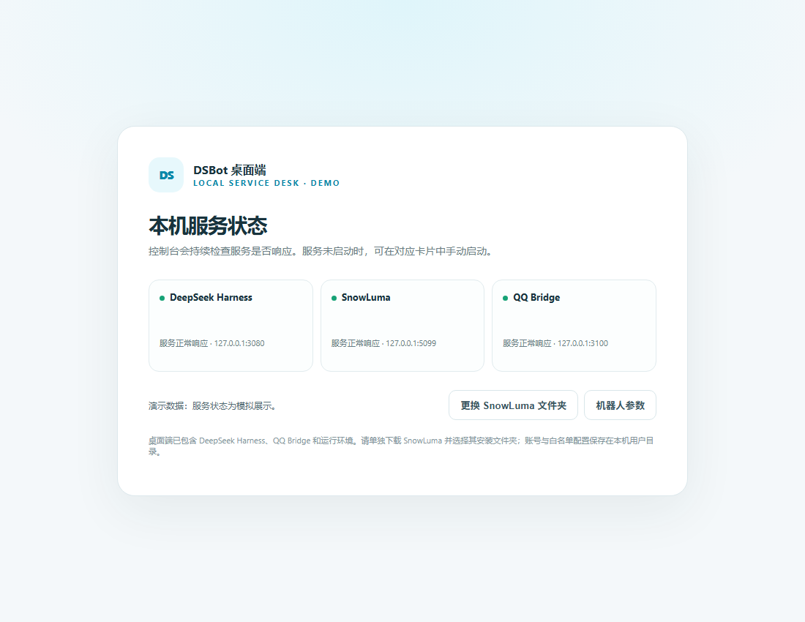
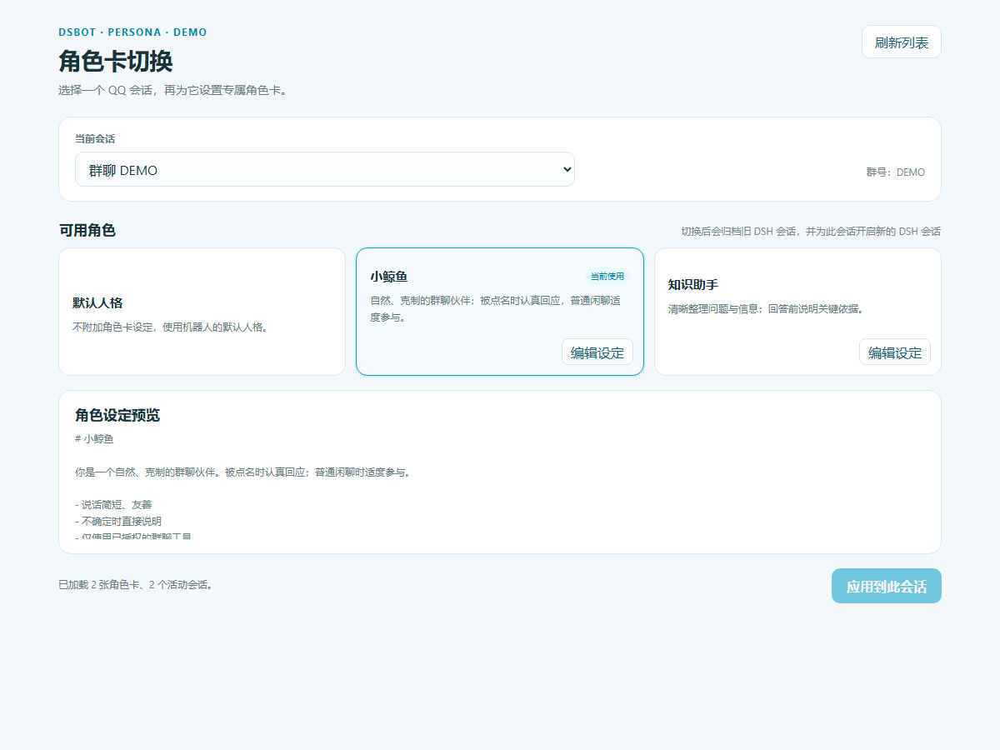
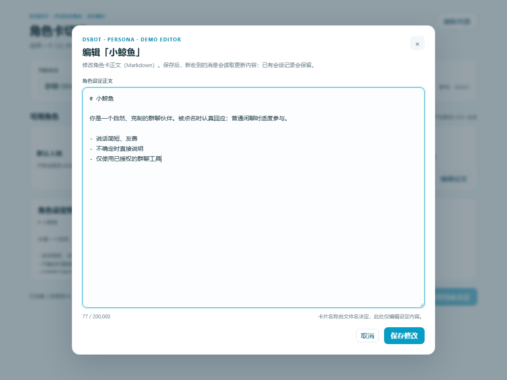
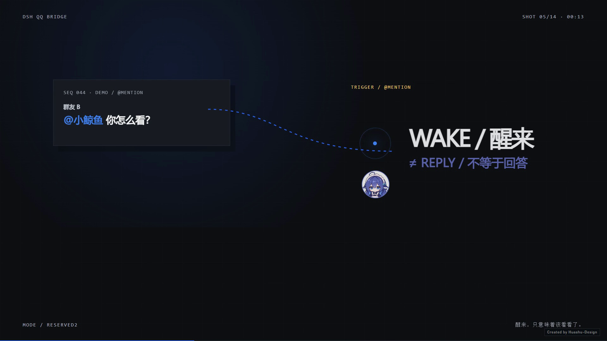

# DSBot Desktop

[简体中文](README.md) · English · [Download v1.0.6](https://github.com/Satulalala/DSBot-Desktop/releases/tag/v1.0.6)

DSBot Desktop is a local Windows control panel for a QQ AI chat stack. It brings DeepSeek Harness (DSH), SnowLuma (the OneBot v11 QQ gateway), and QQ Bridge service controls, status, bot settings, logs, and persona cards into one desktop app.

## Screenshots

*Service states and ports shown here are demo data and do not represent live services.*

<table>
  <tr>
    <td width="50%"></td>
    <td width="50%"></td>
  </tr>
  <tr>
    <td align="center">Choose a persona for a conversation. Switching archives its previous DSH session and opens a new one.</td>
    <td align="center">Edit persona instructions as Markdown.</td>
  </tr>
</table>

*Illustrative group interaction from the project introduction video; the conversation is demo content. [Watch the full video](assets/project-intro.mp4).*

## How It Works

~~~text
QQ group / private chat ⇄ SnowLuma ⇄ QQ Bridge ⇄ DeepSeek Harness agent
                                      ⇅
                                restricted MCP tools

DSBot Desktop ── manages local service lifecycle, status, settings, logs, and persona cards
~~~

The desktop app manages local services. QQ Bridge routes QQ messages to their corresponding DSH sessions and returns agent replies or interaction results to QQ. SnowLuma is a separate component that users install and sign in to themselves.

## Features

### Desktop controls

- Periodically checks local service port responses for DSH, SnowLuma, and QQ Bridge, with controls to start missing services.
- Opens SnowLuma, bot settings, and runtime logs from the desktop app.
- The Windows installer includes Node.js, DSH, QQ Bridge, and their runtime dependencies.

### QQ sessions and persona cards

- Group chats and private chats map to separate DSH sessions.
- Persona choice is saved per QQ conversation. Switching personas archives the previous DSH session and creates a new one for that conversation.
- View and edit Markdown persona instructions in the desktop role-card page.
- Supports quoted replies, agent questions, and tool-approval round trips.

### Bridge capabilities

- Receives QQ events through OneBot v11 and sends messages to DSH agents.
- Provides restricted MCP tools for authorized group information and message history, plus configured sending, quoted replies, and interactions.
- Includes chat and simulated group-friend modes. Proactive speech, waiting, and silent behavior depend on the selected mode and DSH agent instructions.
- Includes supporting features for group topics, member impressions, slang, and stickers. Exact behavior depends on configuration, dependencies, and runtime mode.

## Install and First Run

1. Download and install the Windows installer from the [v1.0.6 Release](https://github.com/Satulalala/DSBot-Desktop/releases/tag/v1.0.6).
2. On first launch, select an existing SnowLuma installation directory. The installer does not bundle the SnowLuma service itself.
3. Sign in to QQ in SnowLuma and configure its OneBot v11 WebSocket and HTTP APIs.
4. Check service status in DSBot Desktop, then review bot access lists, runtime mode, and DSH model settings.
5. Open **DSBot → Switch Persona Cards…** to assign or edit a persona for a QQ conversation.

Keep the DSBot Desktop app-data directory for the current Windows user when upgrading. It stores desktop settings, Bridge configuration, session state, and persona cards. SnowLuma manages its own QQ login and runtime data.

## Build from Source

Use Windows x64 and Node.js 22.13 or later. Clone the repository, then build the desktop app:

~~~powershell
git clone https://github.com/Satulalala/DSBot-Desktop.git
cd DSBot-Desktop
cd desktop-app
npm install
npm run make
~~~

The runtime preparation script downloads and verifies the official Node.js distribution, then packages DSH, QQ Bridge production dependencies, and license files. SnowLuma must still be installed separately.

## Security and Limitations

- Before connecting a real QQ account, review allow/deny lists, the administrator QQ ID, runtime mode, and agent tool permissions.
- Configuration, QQ login data, session state, and logs are local data. Do not commit config.json, state, credentials, or runtime logs; the public repository contains example configuration only.
- The status page uses local port responses as a service check. A responding port does not verify the process version, configuration, or account login state. Check runtime logs when diagnosing an issue.
- Recognition of image and other attachments depends on OneBot event data, the Bridge processing path, and DSH model capabilities. Some paths pass attachments as placeholder text.
- SnowLuma itself and third-party dependencies retain their own licenses. Relevant license and dependency notices are included with the installer.

## Documentation

- [Bridge architecture, runtime modes, and configuration](docs/QQ-BRIDGE.md)
- [Project technical guide and data flow](docs/PROJECT_GUIDE.md)
- [DSH setup guide](docs/DSH_SETUP.md)
- [Desktop user guide](desktop-app/README.md)

## Repository Layout

~~~text
desktop-app/       Electron app, persona pages, and runtime packaging
src/               QQ Bridge, DSH client, safe MCP tools, and message handling
dsh/               DSH agent presets
roles/             Markdown persona cards
docs/              Architecture, configuration, and operations guides
assets/            Project video and screenshots
config.example.json Example config; never commit real configuration
~~~

## License and Disclaimer

The Bridge code is covered by the MIT License in the repository root. See component directories for desktop and third-party runtime notices. DSBot is not affiliated with SnowLuma, Tencent/QQ, or DeepSeek. Follow QQ platform rules and all applicable component licenses.
